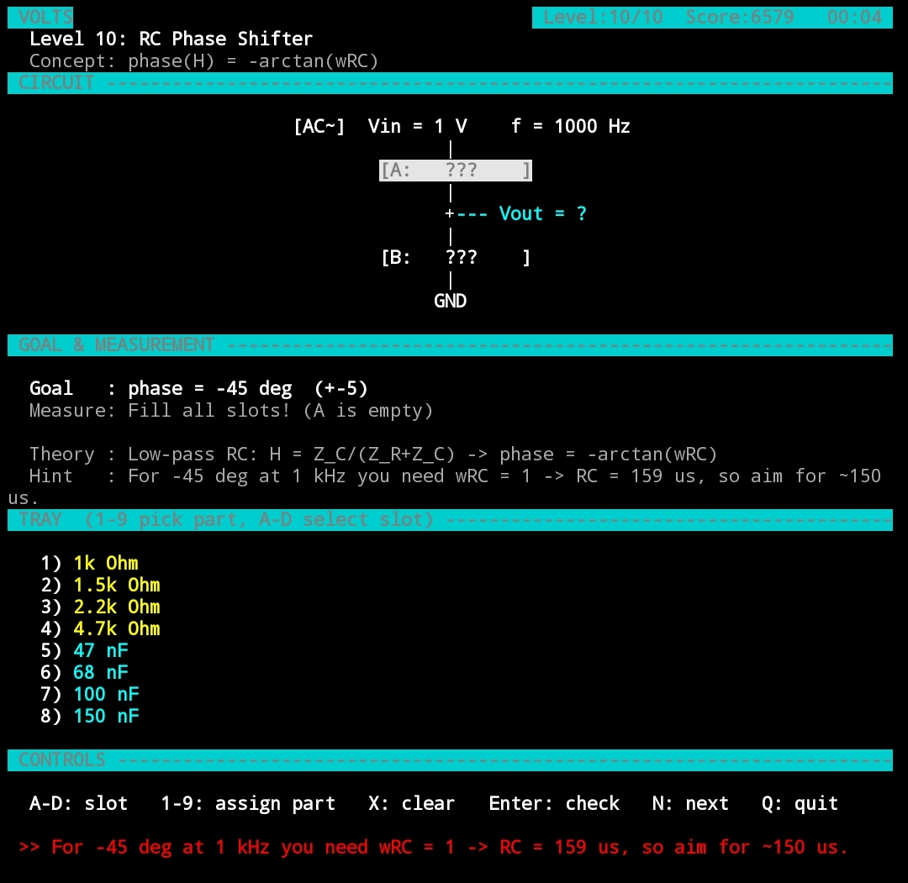

# VOLTS

A terminal puzzle game for electrical engineers. Each level shows a small circuit with empty slots; pick parts from the tray so the circuit meets the stated goal. The game solves the circuit for you using real equations (Ohm's law, KVL/KCL, Thevenin, complex impedance) and shows live measurements as you swap parts.

Written in plain C99 with ncurses. No other dependencies.



## Levels

| # | Level | Concept |
|---|-------|---------|
| 1 | Voltage Divider | KVL + Ohm's law |
| 2 | Load Effect | Thevenin's theorem |
| 3 | Current Divider | KCL |
| 4 | Max Power Transfer | Thevenin + maximum power transfer |
| 5 | LED Driver | Ohm's law, safe operating region |
| 6 | RC Low-Pass | `fc = 1/(2πRC)`, magnitude of H(jω) |
| 7 | RC High-Pass | magnitude and phase of a CR filter |
| 8 | Series RLC Resonance | `f0 = 1/(2π√LC)`, `Q = ω0·L/R` |
| 9 | RLC Bandwidth | `BW = R/(2πL)` |
| 10 | RC Phase Shifter | `φ = −arctan(ωRC)` |

AC levels use complex impedance: `Z_R = R`, `Z_C = 1/(jωC)`, `Z_L = jωL`, and compute `H(jω) = Vout/Vin`.

## Build & run

You need a C compiler and the ncurses development headers.

```sh
# Debian / Ubuntu
sudo apt install build-essential libncurses-dev
# Fedora
sudo dnf install gcc ncurses-devel
# macOS (ncurses ships with the system; Xcode command line tools are enough)
xcode-select --install

make
./volts
```

Or without `make`:

```sh
gcc -std=c99 -Wall -Wextra -o volts volts.c -lncurses -lm
```

Use a terminal with color support, at least ~100 columns × 45 rows.

## Controls

| Key | Action |
|-----|--------|
| `A` `B` `C` `D` | Select a slot |
| `1`–`9`, `0` | Put that tray part into the selected slot |
| `X` / Backspace / Delete | Clear the selected slot |
| `Enter` | Check your answer |
| `N` | Next level (after solving) |
| `Q` | Quit |

Faster solves score more points.

## Adding a level

Levels are plain data in the `LEVELS[]` table in `volts.c`: a title, concept, formula, hint, topology, source values, slot definitions (with the required part type), the part tray, and a goal. If your circuit needs a new topology, add an enum value, a case in `simulate()`, and a `sch_*()` drawing function.

## License

MIT — see [LICENSE](LICENSE).
